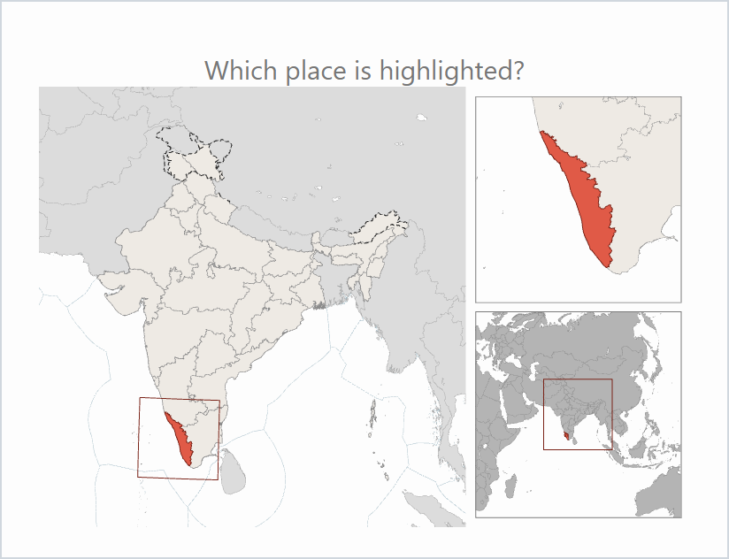
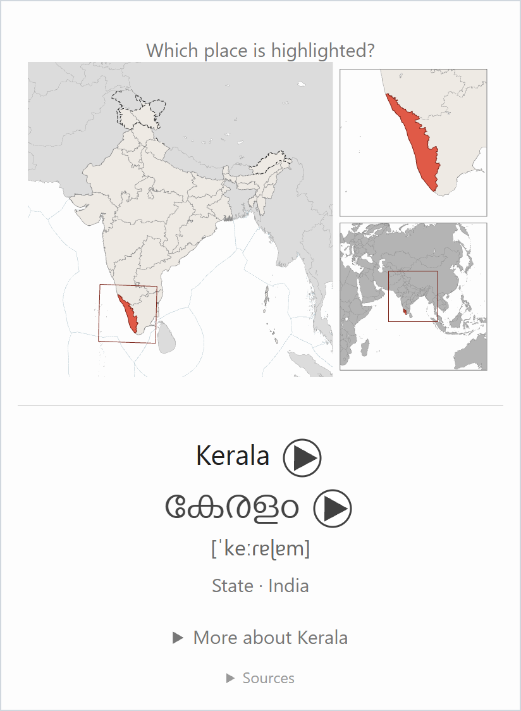
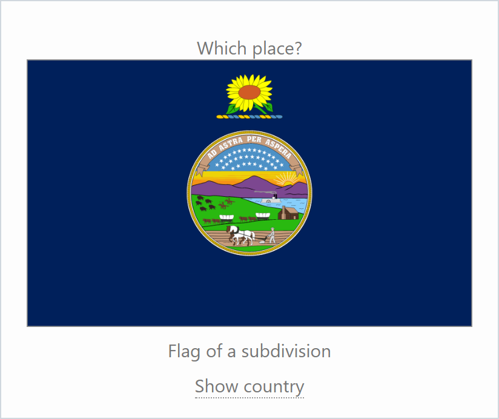
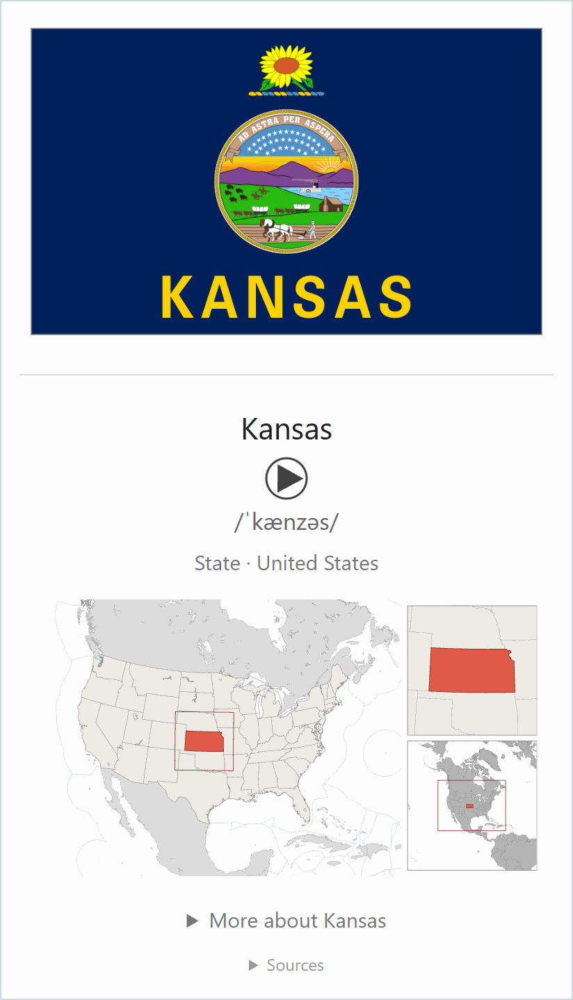
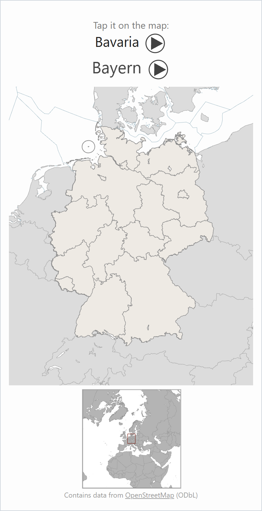
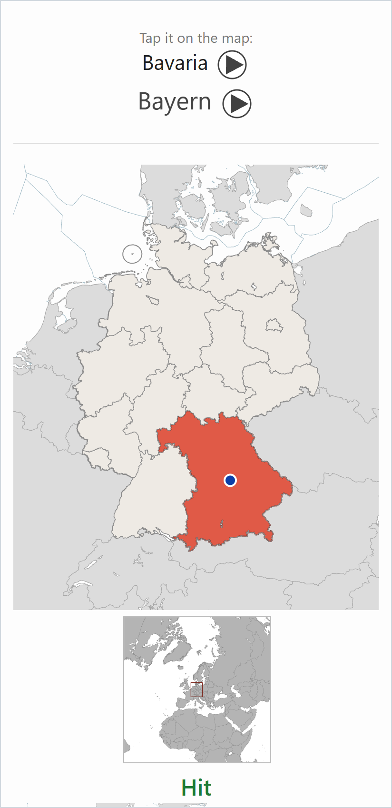
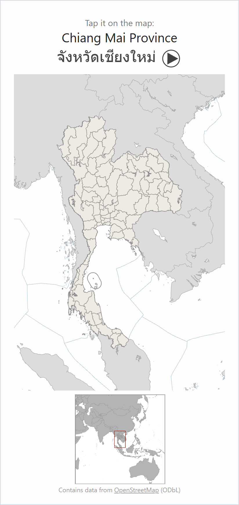
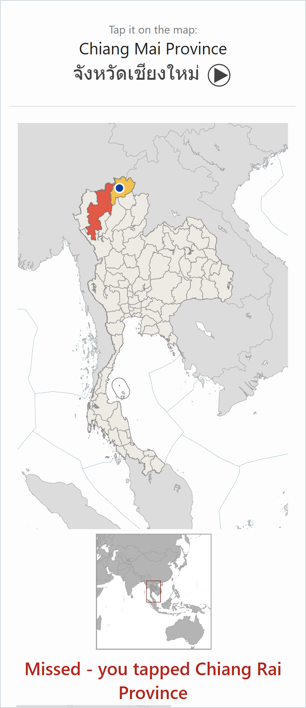
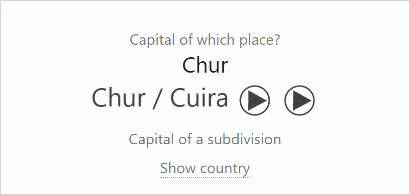
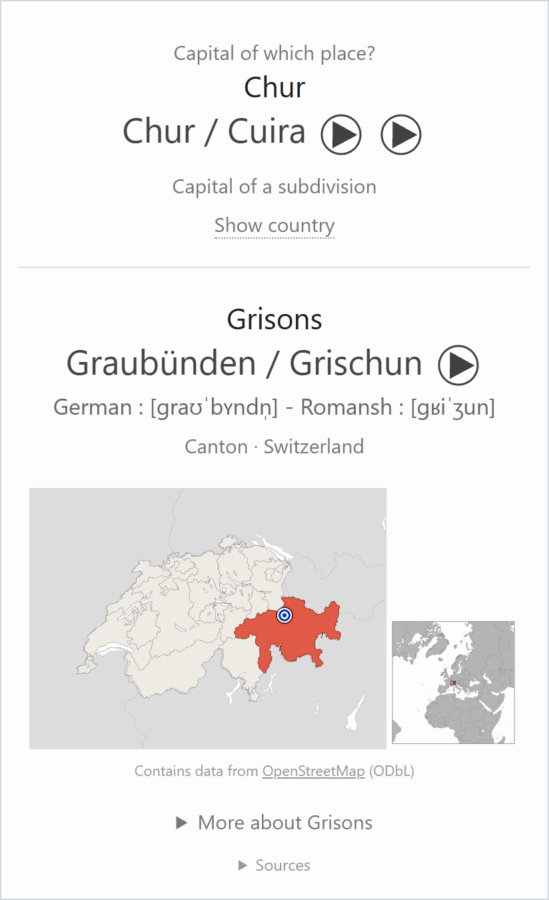

# World in Flashcards: prebuilt decks

Anki decks of the world's countries, territories and their first-level subdivisions: where each one is, its
flags and emblems, its capital, and its name in English and in its own language, with pronunciations.

Each version is a [GitHub Release](https://github.com/world-in-flashcards/decks/releases) with two files
attached:

- `World_in_Flashcards.apkg` - the deck, to import into Anki;
- `manifest.json` - every note's code, fields and media files, so the deck can be checked without opening Anki;

and `capital_points.tsv` with its licence note (see [Licence](#licence)).

## What the cards look like

Four cards from the world deck, the question on the left and the answer on the right, rendered from the deck's
card templates at phone width, without Anki's window around them.

<table>
<tr><th>Question</th><th>Answer</th></tr>
<tr><td colspan="2"><b>Map -> place.</b> The place highlighted on its country's map, with a closer view and its
place on the globe. The answer gives the English and native names, the IPA and recordings.</td></tr>
<tr><td valign="top"></td>
<td valign="top"></td></tr>
<tr><td colspan="2"><b>Flag -> place.</b> Lettering that names the place is painted out of the question's
picture; the answer shows the flag as published, with the place's map.</td></tr>
<tr><td valign="top"></td>
<td valign="top"></td></tr>
<tr><td colspan="2"><b>Place -> map.</b> Tap the place on its country's map; the answer judges the tap and
shows where the place is.</td></tr>
<tr><td valign="top"></td>
<td valign="top"></td></tr>
<tr><td colspan="2">A miss on the same kind of card: the answer marks the tap, names the place tapped and shows
the one asked.</td></tr>
<tr><td valign="top"></td>
<td valign="top"></td></tr>
<tr><td colspan="2"><b>Capital -> place.</b> The capital in English and in its own languages; the answer marks
it on the place's map.</td></tr>
<tr><td valign="top"></td>
<td valign="top"></td></tr>
</table>

## What is in it

One note per region, keyed on its ISO 3166 code (or a GADM code where ISO has none). A note makes only the
cards its fields can fill:

| card | asks |
|---|---|
| Flag -> place (up to three) | which place flies this flag? |
| Emblem -> place (up to two) | whose coat of arms, seal or logo is this? |
| Map -> place | which place is highlighted? |
| Capital -> place | which place has this capital? |
| Place -> capital | what is this place's capital? |
| Place -> flag | what does this place's flag look like? |
| Place -> map | tap the place on the map |

The back of every card shows the native name and its IPA, a "More about ..." fold (languages, status, every
flag and emblem, ISO codes, currency, calling code, internet domain) and the sources the card's content came
from. On the question side, a flag's or emblem's lettering that would give the answer away is painted out;
the back shows the picture as published.

The decks are nested: `World in Flashcards::Regions` holds the cards, under a top-level `World in Flashcards`
whose description lists the data sources.

Tags, all under `WiF::`, let you study a part of the world:

- `WiF::continent::africa::western-africa` - UN M49 regions;
- `WiF::country::France` - a country with its subdivisions and dependencies;
- `WiF::level::country-or-territory`, `WiF::level::subdivision`;
- `WiF::region-type::sovereign-state` and the other types;
- `WiF::feature::landlocked`, `WiF::feature::eponymous` (the capital is named like the place) and others.

In the browser, search for example `tag:WiF::continent::europe tag:WiF::level::country-or-territory`, then use
it as a filtered deck.

## Importing

1. Download `World_in_Flashcards.apkg` from the latest release.
2. In Anki on a computer: **File > Import**, choose the file, and import with the default options.
3. Sync, if you study on a phone or on AnkiWeb.

The deck is large (the world deck is about 470 MB, mostly maps and flags), so the first sync takes a while.

Pronunciations play automatically on the cards that have them. To stop that, tick **Don't play audio
automatically** in the deck's options (the Audio section).

The tap-the-place cards were tested on Anki for desktop, AnkiDroid and AnkiWeb. Night mode is supported.

## Updating to a new version

Import the new version's `.apkg` the same way, with the default options. Every note keeps the same identity
from version to version, so the import **updates** your notes in place: your review history and scheduling
are kept, and no duplicates appear.

- Anki's default is to update a note only from a newer file, and every release is newer than the last.
- An update overwrites the fields of the notes it updates, so an edit you made to one of them is lost. Put
  your own notes in a field of your own note type, or keep a copy, if you change cards.
- A card new in the release arrives in `World in Flashcards::Regions`, even if you moved the old ones
  elsewhere; cards you moved stay where you put them.
- A region removed from a release (a unit that was abolished, say) is not deleted from your collection: the
  changelog lists it, and you can delete it yourself.

What changed in each version is in [CHANGELOG.md](CHANGELOG.md).

## Reporting an error

Open an [issue](https://github.com/world-in-flashcards/decks/issues): name the card (its English name, or the
code from the manifest), what it says, what it should say, and a source if you have one.

## Licence

This project's own work - the card text, the maps, our redrawn flags and emblems, and the deck as a
compilation - is under the [MIT License](LICENSE), Copyright (c) 2026 Jens Nordmark.

Every map, picture and recording **also keeps its source's own terms**, named under "Sources" on the back of
its card. In particular:

- **Non-commercial only.** Some sources allow only non-commercial use: GADM's boundary data (from which many
  subdivision maps are drawn) and the drawings from FOTW Flags Of The World. Do not sell the deck or use it
  commercially.
- **Share-alike.** The maps of Austria's and Greenland's subdivisions are CC BY-SA (from the Government of
  Austria's data via GADM, and from geoBoundaries' Wikipedia-derived file for Greenland), as are the flags and
  emblems whose own licence is CC BY-SA.
- **OpenStreetMap.** Maps drawn with OpenStreetMap data say so under the map. The capital points the cards
  show are released beside each deck as `capital_points.tsv`, under the Open Database License (ODbL) 1.0, as
  its licence note explains.
- **FOTW Flags Of The World.** Flags and emblems drawn by FOTW's contributors are used under the site's terms,
  https://www.crwflags.com/fotw/flags/disclaim.html: at most 5% of its images, the author and the site
  quoted, non-commercial and non-political use only. Each such picture's card names its author and the site;
  the terms' full text is in the deck description and in `manifest.json`.

## Data sources

**Maps**
- Natural Earth - public domain - https://www.naturalearthdata.com/
- GADM 4.1 - https://gadm.org/; Austria's data the Government of Austria's, CC BY-SA 2.0
- geoBoundaries (gbOpen) - each country's file under its own licence (CC BY, CC BY-SA, ODbL or public domain),
  named on its cards - https://www.geoboundaries.org/
- Overture Maps Foundation, divisions and base (OpenStreetMap contributors, ODbL 1.0; Esri Community Maps,
  CC0) - https://overturemaps.org/
- OCHA Common Operational Datasets, administrative boundaries (COD-AB), via HDX - CC BY-IGO -
  https://data.humdata.org/
- World Bank Official Boundaries - CC BY 4.0 - https://datacatalog.worldbank.org/
- Marine Regions, Maritime Boundaries (EEZ) v12 - CC BY 4.0 - https://www.marineregions.org/

**Flags and emblems**
- Wikimedia Commons and Wikipedia, government websites, and FOTW Flags Of The World - each picture's file,
  author and licence on its card.
- Redrawn pictures: drawn by World in Flashcards Map Renderer, CC0.

**Names, facts and codes**
- Wikipedia and Wiktionary - CC BY-SA 4.0; Wikidata - CC0
- GeoNames - CC BY 4.0 - https://www.geonames.org/
- PCGN Toponymic Factfiles - Open Government Licence v3.0
- UN M49 standard regions - UN Statistics Division
- ISO 3166, ISO 4217 (List One), the ITU's country codes and IANA's root zone, for the codes

**Pronunciations**
- Wikimedia Commons and Lingua Libre - each recording's file, author and licence on its card.
- Voice of America Pronunciation Guide - public domain.
